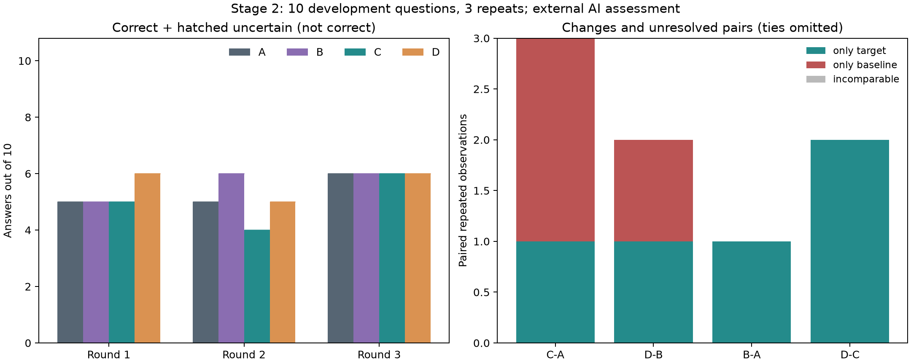

# MetaMem 第二阶段研究包：缺失与利用问题并存，角色预算未显示收益

本轮完成两题oracle诊断、一个通用检索候选的实现与训练审计、固定十题四组各三次真实生成、外部AI评审与独立复核，以及可复现交付。**结论不支持将角色均衡预算替换原BM25默认检索。** 代码作为可选对照保留；不是全组最终方案、论文完整复现或独立测试成绩。日期为本地2026-10-15，UTC跨至10月16日。

## 交付索引

|产物|入口|
|---|---|
|研究结论、逐题与成本|本文|
|冻结方案与生成设置|[阶段计划](../configs/metamem-stage2-plan.json)、[生成配置](../configs/qwen-stability-sampling.json)、[严格拒答v2](../configs/external-ai-strict-abstention-v2.json)|
|来源与事实差异|[证据审计](metamem-stage2-evidence.md)、[简明fact ID差异](../reports/metamem-stage2-fact-diff.json)；完整原文在本地`output/stage2-preparation/`和`output/stage2-retrieval/`|
|实际命令及恢复|[运行说明](metamem-stage2-reproduce.md)|
|约十分钟讲解|[中文讲稿](metamem-stage2-explanation.md)|
|论文对应清单|[方法核对](metamem-stage2-method.md)，直接核对原文第3–5、11页|
|结构化统计与图表|[结果JSON](../reports/metamem-stage2-results.json)、[PNG](../reports/metamem-stage2-results.png)、[SVG](../reports/metamem-stage2-results.svg)|
|原始运行|`output/stage2-experiment-20261015/`保留中断；`output/stage2-experiment-20261015-resume1/`保留恢复、最终回答及统计|
|AI评审原件|最终`smoke/reviews.json`、`summary.reviewed.json`；`output/stage2-independent-review/`；晚餐质量`output/stage2-quality/`|

没有重训规则、付费请求、新模型或测试题/答案读取。提取训练原史时增量解析原始数据、只保留20个训练ID，其余记录丢弃且不向评审展示；这不等于完全未触及原始文件中其他字节。人工验收字段均为空。

## 1. 设计与对照

原任务起点epoch1792119847，四小时/180请求上限；先保存方案、政策与来源，生成前固定全部输入哈希。计划12条oracle＋120条主实验＋1预热=133请求，留47次排障；实际因恢复额外预热一次，共134，不追加采样。

固定Qwen2.5-7B-Instruct Q4_K_M、Ollama0.34.0、8192上下文、temperature0.7/top_p0.95、max_tokens1024，无seed。规则为v1训练的原rules-01，不更新权重或文本。相同检索的有/无规则共享同一事实哈希；回答提示词保持不变，参考仅进入事后评分包。三轮次序依次ABCD、DCBA、CADB，每轮固定原十题顺序。

|组|检索|规则|
|---|---|---|
|A|原BM25|无|
|B|原BM25|原学习规则|
|C|角色均衡BM25|无|
|D|角色均衡BM25|原学习规则|

两题oracle也用无规则、同一生成设置，各条件三次。补入对应真实历史chunk并优先呈现，再用原事实填充；不是把答案写成记忆。上限仍20块/12000字符，但晚餐原9996字符、oracle9306，首饰均12000（19→20块）。所以oracle是覆盖与呈现的联合诊断，不是完全等长、只改变一个token的因果实验；更不是自动检索提升。

## 2. 为什么选这个自动候选

最多考虑了角色预算与会话邻域两项，未实现后者。训练20题没有可靠完整证据标注，不报召回率；可核验工程事实是assistant占原检索字符67.54%，其中有长建议，也有SIAC_GEE必要答案。选最小通用规则：沿原BM25分数、分块和稳定排序，user与other各最多10块/6000字符，最后恢复全局BM25顺序，不回填余量、不删除全部assistant、不按题号/答案/正确会话分支。运行时只使用问题及历史。

[实现](../src/metamem_pilot/role_retrieval.py)可对任意相同字段的历史调用`retrieve_balanced(row)`；原`retrieve`未改，候选不成为默认。训练审计完成后冻结，不按十题生成得分调参。

训练字符216012→183573，块388→340，新增25/移除73；user字符70126→63573，只有6题增加、14题减少。因此不能把该候选表述成单向增加用户证据。开发字符112864→97400，降低约13.7%，是同上限而非同实际长度。

关键证据审计的结论很明确：**没有补回晚餐的两个必要来源chunk，也没有补回首饰戒指；所有已知关键fact的存在、名次及全文保留状态未改变。** 候选173条文本均可回接原史。改变的是其他块与长度，含一条Sapiens干扰块只剩16字符日期前缀；本轮保留这个局限，不见分数后修参重跑。观鸟六条晚于问题时间的事实也仍在。

## 3. Oracle诊断：补齐证据改变了什么

|题|原检索判对|补齐后判对|能解释什么|
|---|---|---|---|
|晚餐|1/3|3/3|补入真实食材使内容更一致地对齐需求；不等于自动检索改善|
|首饰|0/3|1/3|唯一匹配3的回答仍漏戒指，不能当作完整证据推理成功|
|合计|1/6|4/6|两个开发案例，不能推定整体瓶颈或泛化收益|

晚餐预先固定的独立质量指标：香草组（basil或mint）与cherry tomatoes两组都实际用于菜品，原检索0/3、oracle3/3。无依据个人归属原3/3明确存在；oracle1条明确、2条uncertain，后两条笼统homegrown ingredients是否也把香草归为自种不唯一。原史只明确番茄自种。质量指标没有替代原正确性，评分允许利用部分偏好。

首饰原史三类物品为项链、耳环、戒指。oracle第1轮仍只列项链和耳环得2；第2轮引用戒指却写：

> “Discussed getting a new engagement ring a month ago, but this is from 28 days ago, so it's not within the last two months.”

第3轮匹配参考3，却使用：

> “Emerald earrings (1 pair, which counts as 2 pieces)”

再加项链1，仍未使用戒指。原评分接受包含正确答案，因此该条保留Yes，质量另记计数依据错误。这是重要评测限制：**答案数字匹配与依据正确不是同一指标。** 没有改标签来制造成功或失败。

## 4. 主实验结果

首评132条，预注册范围独立复核72条（全部oracle、全部拒答/衣物/观鸟，以及主要比较标签不同的同题同轮完整四组），标签全部一致，无uncertain。另有6条晚餐质量评审，其中2个归属字段uncertain。共210条AI评审记录，不是210个独立回答；精确部署版本未知，未经人工验收，一致也不代表judge准确。

评审隐藏配置名、规则与历史分数；初评使用新上下文，复核者有证据背景，回答本身也可能泄露行为线索，故不称严格盲评。原初判、复核与保守派生分别保存。既定分歧处理为uncertain，本轮没有触发。

|轮次|A判对|B判对|C判对|D判对|
|---|---|---|---|---|
|1|5|5|5|6|
|2|5|6|4|5|
|3|6|6|6|6|
|合计|16/30|17/30|15/30|17/30|

四组每轮有效覆盖10/10，总覆盖各30/30；uncertain、缺失及生成失败均0。只有10道开发题，每题重复三次，不是30道独立题；这十题已用于方法分析，不能作独立泛化证明。没有用旧实验分数相减计算提升。

|比较：目标−基线|同对|同错|仅目标对|仅基线对|不可比|
|---|---|---|---|---|---|
|C-A|14|13|1|2|0|
|D-B|16|12|1|1|0|
|B-A|16|13|1|0|0|
|D-C|15|13|2|0|0|

C−A三轮判对差0、−1、0；D−B为+1、−1、0。角色预算没有一致方向。B−A仅在第2轮观鸟多一题；D−C的两题差异均来自明信片前两轮。它们是采样观察，不能分离规则、上下文长度、顺序与随机性的因果贡献。四组两个拒答题均0/6，规则没有稳定阻止缺证据后的猜测。

图左是每轮十题的判对数（斜线保留给uncertain，本轮为0）；图右只显示非平局配对，不能把遗漏的平局当作缺失。

## 5. 逐题结果与失败归因

Y/N按三轮顺序。来源原文、会话时间、turn与rank见证据文档；额外原史从未偷偷加入四组主实验。

|ID/题目|A|B|C|D|解释与保留边界|
|---|---|---|---|---|---|
|a96c20ee_abs 海报|NNN|NNN|NNN|NNN|已有相关但不充分线索；四组都把研究事件混同，未正确拒答。|
|7a87bd0c 整理|YYY|YYY|YYY|YYY|4周原证据保留；四组均能使用。|
|9d25d4e0 首饰|NNN|NNN|NNN|NNN|自动候选仍缺戒指；oracle补齐后也漏用/误读日期。|
|4388e9dd Andy|YYY|YYY|YYY|YYY|用户指令及assistant剧本直接证据保留；四组均正确。|
|06f04340 晚餐|YYY|YYY|YNY|YNY|关键食材会话仍未召回；C/D第2轮失分，不能归为关键证据被移除。|
|ad7109d1 网速|YYY|YYY|YYY|YYY|500Mbps用户自述保留；四组均正确。|
|cc6d1ec1 观鸟|YNY|YYY|YYY|YYY|C/A与B/A唯一正差都在第2轮；允许差一单位，且给定历史含未来时间异常。|
|2311e44b_abs Sapiens|NNN|NNN|NNN|NNN|无当前页数仍猜测，四组均失败；没有正确拒答。|
|01493427 明信片|NYY|NYY|NNY|YYY|17/8/25均保留，差异来自相同证据下累计/增量运用及采样。|
|0a995998 衣物|NNN|NNN|NNN|NNN|各组未匹配3；参考第三件口径仍待核实，不能把所有No解释成确定语义错误。|

主要比较变化只集中在晚餐、观鸟、明信片：C−A第2轮观鸟由错到对，但晚餐与明信片由对到错；D−B第1轮明信片变对、第2轮晚餐变错。已知关键证据在两检索条件均未改变，因此不能把这些分数变化归为“召回了正确证据”；可能涉及其他上下文干扰、长度与采样，当前不能进一步归因。

整体不宜二选一断言“主要都是检索”或“主要都是模型”：晚餐有清楚的缺失证据作用；首饰补齐后仍利用失败；明信片已有证据却混淆累计与增量；不可答题持续错误推断；参考口径和宽松judge又影响判对含义。这十题只能支持这些具体诊断。

## 6. 成本、异常和核验

|主组|真实请求|输入tokens|输出tokens|调用秒数|
|---|---|---|---|---|
|A|30|97494|11074|121.34|
|B|30|98214|10537|116.04|
|C|30|86814|9488|104.43|
|D|30|87534|10119|110.77|

全轮本地134请求=132回答+2预热；输入407468、输出46577 tokens，累计调用515.345秒。两次加载到清理监督器合计545.404秒，约9分5秒，不等于包含离线准备/评审/Git的全轮工时。GPU每5秒采样峰值5142MiB。C相对A输入tokens约少11%，但不构成非劣或速度提升证明：样本少、顺序/缓存/重启均可能影响耗时。

第93条答案成功后发生一次WinError5原子替换拒绝访问（具体占用者未确定）。首次会话保留failed及94请求；新增最多约1秒、仅PermissionError的保存重试，并从sampleID唯一且完整prompt匹配的成功日志恢复1条。恢复新目录沿原四小时时钟，继承94请求，只继续39条未开始回答＋1次预热，没有重复生成已完成题，也没有改变配置、规则或事实。`calls.inherited.jsonl`使成本可追溯。

实际核验：4项针对性单测通过；132条真实prompt逐字重建一致且payload哈希吻合；132唯一答案，没有重试或重复；最大输入token加输出预算4867<8192，服务134条记录truncated=0、finish均stop。质量队列也回绑原问题/完整回答/hash，引句逐字匹配。原v1运行51文件及第一阶段6个关键文件哈希未变；两段已闭合生成产物另存哈希清单。

独立代码复查修复了pending计数去重、执行顺序与计划校验、质量输入回绑；实际故障后的恢复修复也作了限域核对。没有无关全仓重构或反复全量测试。完整运行日志和大数据不入Git。

两次模型卸载均返回unload，随后模型列表为空；所属服务/worker退出、11436释放，最终Ollama进程为空、GPU0MiB/0%。未关闭无关应用、未设置自动续跑。

## 7. 保留与下一步

**保留角色预算实现作为可复查的可选负结果，不替换原BM25默认。** 它降低了输入预算，但没有补齐已知缺口，也没有一致判分收益；这既不证明一切检索改进无用，也不是项目失败。

下一阶段只推荐研究**回答提示词中的证据绑定与停止猜测**：固定首饰、明信片、海报、Sapiens四道开发题，原提示词对照一个预先固定的“对象/事件—来源—时间窗口—计数或缺失”提示词，各三次，共24回答加1预热。事实、模型、规则配置不变，单独记录最终正确性、依据链是否正确和无依据具体断言；本轮不执行。

它要回答：已有充分证据能否被正确利用、缺失时能否停止猜测。选择这一方向的依据是oracle首饰仍未形成正确计数路径、明信片已有证据仍误算、四组拒答均失败；不是为了追求更多Yes。晚餐会话遗漏仍是检索问题，后续不能因本候选失败而忽略它。衣物参考第三件和观鸟时间口径仍需人核对，当前不改基准标签、不填写人工验收。

## 交付核对

限定最终结论复查核对机器统计、配对方向与oracle推理解释，通过；将“能力上界”收敛为补齐并前置证据的能力诊断。图表实际渲染并查看，文档相对链接通过。全轮工时、提交、推送及草稿PR回执记录在本地`output/stage2-delivery.json`，不以两段GPU会话时间冒充总工时。
