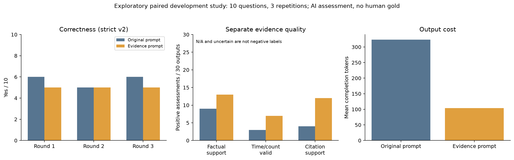

# 第三阶段：证据约束提示词的收益与代价

2026-10-16，杨垚的MetaMem个人开发试点。本轮完成原BM25、同一Qwen7B、无规则下，两种回答提示词对十题各三次的60条新回答。候选在生成前冻结，前四题24条只做运行检查，后六题36条照原计划完成；没有根据早期分数修改方案。测试题及答案未读取、未运行。

## 研究问题与对照

候选是否改善已有事实的利用、时间/数量理解与缺证据时拒答，同时不损害原本正确回答？[通用候选](../configs/evidence-answer-v1.txt)要求区分对象/事件/时间、累计/增量/件与对；给短依据并引用实际fact ID，证据不足时说明缺失并停止猜测，一般推荐不冒充个人经历。没有写入题号或答案。

这是一个整体提示词包对照，同时改变依据指令与简洁性要求，不能把结果归因于其中某一句。短回答也减少了出现额外错误断言的机会；质量正项增加不直接证明内部推理能力提高。设计借鉴了前两阶段开发诊断，因此仍是探索性开发评估；十题重复三次不是30道独立题。基线本轮重新生成，未把历史成绩代作主对照。

两组都调用相同原BM25 facts、question date、Qwen2.5-7B-Instruct Q4_K_M、Ollama0.34.0，temperature0.7/top_p0.95、输出1024、服务上下文8192；均空规则，未设seed，不宣称相同随机噪声配对。轮次顺序原/新、新/原、原/新。全部60实际提示词与请求payload已重建核对；最大输入tokens＋输出预算4917，小于8192。计划、政策与文件哈希见[冻结计划](../configs/metamem-stage3-plan.json)。

生成前采用原则：综合正确性、事实支持、过度拒答、跨题跨轮一致性与输出成本；不事后挑最好数字，不因小幅开发优势自动切换默认配置。即使有局部收益也只保留候选；没有清楚收益则记录负结果，不启动第四种方案。

## 评分与一次复核

正确性为原rubric加本项目strict-abstention-v2，Yes/No/uncertain；拒答题承认不足又猜实际数值仍为No。偏好题仍按原标准允许部分个人信息利用，不把“所有额外事实必须检索支持”偷偷加入正确性标准。时间原rubric的off-by-one容差保留。

独立[依据质量v1](../configs/evidence-quality-v1.json)分别记录事实支持、时间/计数成立、引用存在、引用支持、信息不足时停止猜测、信息足够时不必要拒答。正确数字但理由错可以正确性Yes且质量invalid；无引用不直接等同事实错误。各维有明确不适用与不确定，不统一补No。

主评先读问题/参考/完整回答/标准完成正确性文件，之后才读实际输入facts做质量；正确性不因质量反改。主评隐藏方法名称、规则和历史标签，但回答风格/引用可透露条件，组织者已有背景，不能称严格盲评。另一个未看主评或映射的AI对38条作一次复核：所有拒答、衣物/观鸟异常，以及主要正确性变化、正确性质量冲突、不确定项的整对回答。保留主评和复核，不反复评到一致；未解决分歧在派生统计变uncertain。

评审者为当前APP中的外部AI，能确认Codex/GPT-6家族，精确部署版本未知。没有人工金标准，人工验收字段null。本地模型请求与APP评审分别统计，不伪造judge API或客户端凭据。

## 结果

**结论：保留为可选研究候选和负结果，不切换默认。** 候选更简短、明信片累计和部分依据质量改善，但正确性17/30降至15/30，海报和Sapiens不足信息猜测仍全部失败，晚餐三轮退步。没有跨多个任务稳定改善的证据。

|轮次|原提示词 Y/N/U|候选 Y/N/U|有效覆盖（各组）|仅候选对 / 仅原对|
|---|---|---|---|---|
|1|6/4/0|5/5/0|10/10|0 / 1|
|2|5/5/0|5/5/0|10/10|1 / 1|
|3|6/4/0|5/5/0|10/10|0 / 1|
|重复观察合计|17/13/0|15/15/0|30/30|1 / 3|

配对同对14、同错12、仅候选对1（明信片第2轮）、仅原对3（晚餐三轮）、不可比0。初判与38条独立正确性复核完全一致；这不等于准确率已由人验证。质量有23个维度分歧、涉及10条回答，未解决的分歧保留uncertain，原意见均保存。

|开发题|原三轮|候选三轮|观察与归因边界|
|---|---|---|---|
|首饰 9d25d4e0|NNN|NNN|漏戒指、日期解释/耳环利用仍错；一次更谨慎不是完整解题|
|明信片 01493427|YNY|YYY|三轮候选正确取累计25；原第2轮错误相减，第3轮虽答对但理由矛盾|
|海报 a96c20ee_abs|NNN|NNN|相关会议仍被当成同一本科课程海报事件|
|Sapiens 2311e44b_abs|NNN|NNN|缺实际进度，仍猜剩余页数|
|整理 7a87bd0c|YYY|YYY|候选三轮事实支持；原第3轮虽然答对仍有时间理由问题|
|Andy 4388e9dd|YYY|YYY|正确性稳定，部分引用指向不支持对应主张的片段|
|晚餐 06f04340|YYY|NNN|缺真实食材检索，候选更集中调酒建议，原rubric分数下降|
|网速 ad7109d1|YYY|YYY|已有500Mbps证据，两组稳定利用|
|观鸟 cc6d1ec1|YYY|YYY|off-by-one掩盖了时间依据错误，另有as-of异常|
|衣物 0a995998|NNN|NNN|参考对象口径未解决，不私改成正确或删题|

Y/N为正确性标签，不代表每句话都有证据。下表六维独立质量采用保守复核，分母保持每组30回答；NA不是错误，U不是No。

|质量维度|原提示词|候选|
|---|---|---|
|事实支持：支持 / 不支持 / U|9 / 19 / 2|13 / 12 / 5|
|时间计数：有效 / 无效 / U / NA|3 / 13 / 4 / 10|7 / 8 / 3 / 12|
|引用存在：有效 / 无效 / 无引用|8 / 0 / 22|28 / 2 / 0|
|引用支持：支持 / 不支持 / U / NA|4 / 3 / 1 / 22|12 / 15 / 3 / 0|
|证据不足停止猜测：是 / 否 / U / NA|1 / 11 / 3 / 15|2 / 8 / 5 / 15|
|不必要拒答：是 / 否 / U / NA|0 / 15 / 3 / 12|0 / 15 / 3 / 12|

依据支持改善主要来自明信片三次、整理一次和首饰一次，观鸟第3轮反而从支持变不支持；不能只报总支持数增加4。候选28条引用ID确实存在，但只有12条引用支持评价为支持，15条不支持、3条U（包含无效引用）；引用更多不是更可信的充分条件。海报与Sapiens共6条不足信息任务，两组停止猜测均0/6，核心拒答目标未达成。

没有观察到明确新增不必要拒答；两组衣物各3条仍U，不能宣称过度拒答风险已排除。首饰确切总数在实际检索中不完整，谨慎拒答与有证据可给下界需区分，不能用参考答案反推“输入足够”。原本正确晚餐被损害是三轮一致的分数退步，但不是过度拒答造成。正确性指标遗漏了明信片/整理理由质量改善，也遗漏了观鸟理由恶化，所以不能只看Yes或只看质量正项。

图中质量柱为30条回答中的正项数量，不把NA/U当负项；详细分母与反项见上表。输出更短有明确工程价值，但未满足预先采用原则中的整体可靠收益。

## 代表性证据与错误归因

1. **明信片：已有证据的局部利用改善。** 同一事实`answer_a7b44747_2:6:0`明确最新累计25。原提示词第2轮计算“25 - 17 = 8”并答8；候选三轮都答25。第3轮基线最终25正确，但过程先称新增8“不属于25”，后又说25包含17和8，质量不能因为最终数字正确自动通过。该题支持局部改善，不支持跨任务泛化。
2. **海报：真实引用并未修复跨事件推断。** 候选三轮都答Harvard，并引用存在的`answer_ef84b994_abs_2:0:0`。该事实只说参加研究会议、见到AI教育项目，不能推出“本科课程研究海报”的大学。六条均未正确拒答；不能把引用率提升写成依据正确率提升。
3. **Sapiens：短回答仍在猜进度。** 候选分别给约300、465、15页，全部缺实际进度；第2轮自行设“2 weeks already read”，第3轮把年度读书目标混进单本剩余页数。原提示词也都错误，包括第3轮约14,871页。候选更短不等于消除了无依据推断。
4. **首饰：漏检与利用问题仍交织。** 原facts未含戒指；候选第1/3轮拒绝给确切总数，第2轮却答1并说没有耳环。第1轮把“上个月15日”写成May15；第2轮引用`answer_fcff2dc4_1`只是会话前缀，不是完整提供的fact ID。不能把缺失总数导致的谨慎回答自动判成过度拒答，也不能据参考3逼模型编缺失戒指。
5. **晚餐：正确性与依据质量需要分开。** 基线菜单碰到原rubric接受的番茄/罗勒等而得分，同时推测用户拥有多种食材；候选集中于检索出的Spicy Mango Margarita，没有满足原偏好rubric，且第3轮直接说“your homegrown mangoes”。真正食材会话仍未召回。这里的分数下降不是成功拒答换来的代价，而是推荐内容与参考不匹配、无依据归因仍在；一般建议本身不额外扣正确性。
6. **观鸟与衣物：评测异常继续保留。** 观鸟3个月可因原off-by-one标准判对，但若没有正确减去工作坊前1个月，质量仍可invalid；历史有晚于问题37分钟的记录，严格as-of结论受限。衣物参考3涉及新旧靴子、未取西装及姐姐处毛衣的对象口径，未改参考/删题，解释不能当成人工确认。

以上引文均来自本轮保存回答，ID可回到完整输入。质量审查只用实际提供facts，不把原史额外找到的证据偷加入模型输入。

## 成本、异常与清理

APP AI评审共196条维度记录＝98条正确性（60主评＋38复核）＋98条质量，涉及60个生成回答；不把196称作独立样本或本地模型请求。APP token不可取得，未记为0。

61次真实本地请求＝1预热＋60回答，失败0、重试0、输出截断0。worker158.46秒、服务会话170.73秒；累计调用157.51秒，输入197,242、输出12,830 token。服务日志61条`truncated=0`，最大输入＋输出预算4917；没有把1024输出上限当上下文。

原提示词30次调用108.61秒、输出9,712 token（平均323.73）；候选45.42秒、输出3,116（平均103.87），输出约减少67.9%。事实不变但提示词本身略长，候选输入99,714 vs基线97,494 token。耗时为本次顺序本地运行观测，不是独立速度基准。

运行中29次GPU采样，显存采样峰值5142 MiB；采样未覆盖最早启动几秒，不冒称瞬时精确峰值。卸载返回done_reason=unload，加载列表models=[]，所属服务23128、runner8732和worker24264退出，11436无监听，独立核查GPU0 MiB/0%。没有关闭其他程序、下载模型、付费服务或自动续跑。

本轮没有运行故障或恢复；执行前审查修复了恢复可能绕过首24条门禁的问题。保留逐次落盘、失败与缺失分离、继承请求数/原截止。另检查统计的质量输入绑定、引用存在性、缺失处理与复核分歧，未改变生成提示词或评分标准。

## 交付索引

|文件|用途|
|---|---|
|[结构化结果](../reports/metamem-stage3-results.json)|逐轮、逐题、配对、质量与成本，小型统计而非完整日志|
|[对照图](../reports/metamem-stage3-comparison.png)|正确性、独立质量与输出成本；仅十道开发题|
|[运行说明](metamem-stage3-reproduce.md)|冻结、实际命令、文件AI复核、停止/恢复边界|
|[统一总报告](metamem-integrated-report.md)|前三阶段及规则学习的研究线索，设置分表|
|[课程差距](metamem-course-readiness.md)、[组员上手](metamem-team-start.md)、[讲稿](metamem-integrated-talk.md)|老师要求、复现与十分钟/两分钟汇报|
|本机`output/stage3-experiment-20261016/`|会话清理、GPU采样、完整回答/调用/主评/质量评审与派生统计|
|本机`output/stage3-independent-review/`|38条一次独立复核、隐藏队列与冻结范围|

原数据、权重和完整运行日志不入Git。历史v1的51个文件、第一阶段6个和第二阶段7个关键文件哈希核验未变。人工验收：________。
