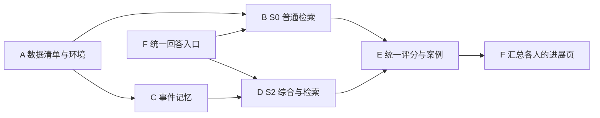

# 长对话结构化记忆复现与轻量优化项目方案

更新日期：2026-10-19。适用范围：天津大学 NLP 第 8 队、6 人小组，老师论文清单中的专题 4、组 2。

项目以 **StructMem 小规模方法复现**为主：使用一个数据集、一种回答模型，完成一个简单基线、主方法和一个消融。复现完成后，优先尝试一个参数调整；只有实际错误案例支持时，才考虑一个局部代码改动。完成标准是实验可解释、可以复跑，不要求超过原论文分数，也不预设必须取得正向提升。

近期节点是 **2026 年 10 月 22 日研讨汇报**。此前先完成真实基线运行，争取形成与原版 StructMem 的小样本对照；不开展优化。六个任务包、认领栏和 10 月 19–21 日安排见第 8–10 节。

六篇论文共同用于阅读与比较，不要求完整实现六套系统。方法与原文依据见[六篇论文复现条件核查](../notes/six-paper-comparison.md)；已有的[论文比较](../notes/paper-comparison.md)和 [MetaMem 个人试点方案](metamem-pilot.md)继续保留。

## 1. 必做范围与难度边界

| 项目 | 必做范围 |
| --- | --- |
| 数据集 | LoCoMo，一个固定小子集 |
| 主方法 | 复用 LightMem 官方实现中的 StructMem，不从零重写 |
| 模型 | 一种 DeepSeek API 回答模型，本地轻量嵌入；明确记录相对论文的替换 |
| 对照 | Flat RAG、StructMem 去掉跨事件综合、完整 StructMem，共三组 |
| 评价 | 同一题集的总体/分类准确率、实际 token 和费用、少量错误案例 |
| 优化 | 可选一个参数调整或一个局部机制，不叠加多个改动 |
| 交付 | 运行说明、配置、实验表和案例分析，与六篇阅读材料共同形成汇报 |

首版不训练基座模型，不使用实验室 DCU，不部署 Hindsight，不增加第二个数据集，不建设图数据库、完整记忆操作语言或网页前端。普通桌面 GPU / 游戏本与几十元 API 预算作为设计条件；复杂模型训练和多系统横评不属于当前验收要求。

六篇论文各自的作用是：StructMem 提供主方法；Hindsight 与 Semantic XPath 帮助理解检索；MetaMem 帮助分析证据利用；HyMEM 提供更新思路；Text2Mem 提供操作和结果校验思路。已有思想的应用或参数调整可以作为课程优化实验，但不声称学术首创。

## 2. 与现有工作衔接

远端已经有 MetaMem 个人试点及后续研究分支。[PR #5](https://github.com/YaoYang-123456/NLP-2026-Team08-Structured-Memory/pull/5) 说明它使用 BM25 与原始会话片段，不是完整 LightMem 复现，也不代表全组选型；[PR #7](https://github.com/YaoYang-123456/NLP-2026-Team08-Structured-Memory/pull/7) 记录了后续本地实验及负结果。

这些工作可为运行记录、失败分类、评分核查和报告提供参考。本方案不要求试点成员重做已经完成的实验；引用结果时保留其模型、数据、开发集使用和评分条件，不与新的 StructMem 对照混算。实施前先检查现有 issue 与可复用代码，再认领具体任务，不让六位成员各建一套运行框架。

平时作业截止为 **2026 年 11 月 1 日 23:59**，按已核对的新通知准备系统性阅读报告、PPT 和约 60 分钟视频，注明真实分工与贡献；小组采用 LaTeX 写作、PDF 交付。通知来源为[老师分享目录](https://pan.tju.edu.cn/link/AABA36B295D0754F22BAE2EC489FA324C5)。阅读材料先完成，课设实验可以随后补充；不能把平时作业截止时间当作全部复现实验的截止时间。课设最终验收节点仍待老师通知。

10 月 22 日研讨是本组新增的阶段汇报节点，与 11 月 1 日阅读作业提交分别安排。研讨突出已经运行的流程、结果和待解决问题，不直接套用平时作业约 60 分钟的视频安排。

## 3. 数据与最小实验

使用 [LoCoMo 官方数据](https://github.com/snap-research/locomo)的 `locomo10.json`，保留会话 ID、session、说话人、时间、原始消息 ID、题型与证据标注。StructMem 原论文使用四类共 1540 道题，不含 category 5；本项目只取固定子集，并明确报告实际会话数与各类题数。

先按会话固定 3 个开发会话和 7 个留出会话，记录 ID 与 seed。同一会话不拆到两侧。10 月 22 日前使用开发会话中的 **30 道固定题目**，覆盖四类题型，先完成 5 题联调，再跑完整的 30 题。会话和题目清单在首次模型运行前冻结，不能看完结果再换题。正式比较从留出会话中按题型、会话分层抽取约 **100 道题**，这一步放在研讨之后。所有方法用同一清单；标准答案只用于评价，不参与记忆构建或问答检索。

| 编号 | 方法 | 目的 |
| --- | --- | --- |
| S0 | Flat RAG：原始对话块的向量检索 | 建立简单可解释的基线 |
| S1 | StructMem 事件抽取，关闭跨事件综合 | 检查综合记忆这一模块的作用 |
| S2 | 完整 StructMem | 主复现结果 |
| O1（可选） | S2 加一个已冻结的调整 | 检查收益和代价 |

这里使用 S 编号，避免与现有 MetaMem 试点的 B0/B1/B2 混淆。S1 与 S2 共享事件记忆和其他配置，只改变跨事件综合。S0 与 S2 是系统对照，不能据此单独归因事件绑定的作用。Full-context 和平铺事实抽取消融不列入首版必做项。

首先采用 StructMem 论文的 1 小时综合窗口、15 个历史种子、问答检索 60 个条目和 5 个综合记忆。回答模型、嵌入模型、题集和裁判保持一致。采用 DeepSeek 与本地嵌入属于方法复现，不能声称严格复现原文 `gpt-4o-mini` / `text-embedding-3-small` 条件下的 76.82%。

## 4. 最小实现方式

复用 [LightMem 中的 StructMem](https://github.com/zjunlp/LightMem/blob/8449d574df6bae1bdf3314a1564da65e2f37e046/StructMem.md)，固定上游 commit；在已有构建、问答脚本外补充必要的数据清单、配置和结果汇总。先核对本地嵌入维度、CUDA 配置、分段/压缩和提示词；详细差异见[核查笔记](../notes/six-paper-comparison.md)。

运行顺序为：原始对话 → 事件记忆 → 可选跨事件综合 → 问答检索 → DeepSeek 回答 → 固定裁判与结果汇总。标准答案只进入最后的评价阶段。

| 位置 | 后续按需放入的内容 |
| --- | --- |
| `configs/` | 样本清单、模型参数和检索参数，不含密钥 |
| `scripts/` | 构建、问答、汇总的少量入口，优先复用现有代码 |
| `src/` | 上游调用的必要适配；有确定改进需求后再加局部逻辑 |
| `reports/` | 实验表、案例和汇报材料 |
| `data/`、`output/`、`tmp/` | 本地数据、记忆、逐题结果和临时产物，不入 Git |

不预建通用插件、服务层或空目录。确定性检查集中在样本隔离、答案未进入回答输入、缓存没有串用、统计分母正确这几个关键点。

## 5. 运行资源与记录

抽取、综合、回答和自动评分使用 DeepSeek API，明确指定非思考模式与输出上限；同一角色的设置在各实验间一致。本地 GPU 只承担轻量嵌入和必要的压缩模型。官方脚本存在 CUDA 默认配置，先验证本机能否运行；不以临时借用 8 卡 DCU 作为解决首版依赖问题的前提。

API 继续按几十元总预算考虑，首次试跑约 5 元作为量级参考，实际消耗以运行记录为准。**不设置成本控制岗位，也不为这次试跑开发计费、预算或缓存管理系统。** 各模块在已有日志中记录模型、调用成功/失败、返回的 token 用量和耗时，汇总时按当日[官方价格](https://api-docs.deepseek.com/zh-cn/quick_start/pricing/)估算费用即可；没有返回用量的失败请求单独注明，不能写成零消耗。

运行入口显式指定固定题目清单，避免误跑全量。记忆和嵌入构建一次后保存复用；复跑先检查已完成的步骤。记忆构建按完整会话处理，费用不能仅按题数外推。用量异常时先查原因，不静默删题或只缩小某一种方法的样本。

## 6. 优化从一个参数开始

本节是三组复现稳定后的可选方向。**10 月 22 日前不做参数搜索或机制改动**，当前也不启动优化实验。

**第一选择是检索数量调整。** 在开发集仅比较问答条目数 30 与原配置 60，综合记忆数保持 5，其他设置不动。比较分类准确率与输入 token，判断能否在质量接近时降低成本；冻结配置后再在留出集评价。这里研究的是质量与成本的权衡，明确展示不同上下文长度，不将更多输入带来的提升说成结构创新。

如果参数实验已给出有解释力的结论，可以到此结束。若开发集反复出现“找到相关事实，却漏掉同事件关键信息”，才考虑将参数优化替换为**有限的同源事件上下文补齐**：先确认上游没有等价实现，利用已有来源 ID 补回少量条目，在相同 token 上限下与 S2 比较。不能把同一 session 共用时间的所有消息当成同一事件；来源信息不足或需要大改抽取结构时，取消这一候选。

本轮不同时开展 BM25 融合、自动规则学习、冲突更新等多条优化路线。已有 MetaMem 试点的相关实验可用于讨论，但不因此给全组增加一套必做复现。优化无提升时保留结果与失败原因，不为追求正结果持续扩大范围。

## 7. 评价与完成条件

必报指标为总体及各题型的正确数/总题数、有效评分覆盖率、各阶段 tokens、费用和耗时。裁判模型与提示词固定，保存原始判定；约 100 题的结果只支持小规模验证，不把一两道题的波动写成稳定优势。

抽取 **10–20 个**成功与失败案例人工核查，覆盖基线和主方法的差异。先按“抽取遗漏、检索缺失、综合错误、证据利用错误”解释具体例子，不强制先建设自动证据覆盖评测工具。使用同源模型回答与判分的偏差需要在这些案例中核查；人工结论与自动判分分别记录。

生成或裁判调用失败与正常答错分开记录，保留预定样本分母和覆盖率。尚有评分失败时将结果标注为未完成，不通过删题抬高准确率。保存上游版本、配置、样本 ID、提示词版本和实际模型信息，确保结果可复跑。

首轮完成一次固定配置对照即可。若要声称某个小提升稳定，再对主方法与候选补做必要重复，并展示逐会话变化；不把三次独立构建、置信区间、第二裁判等完整研究流程作为首版门槛。

**基础验收：** 三组在相同题集上完成，能说明配置与论文差异，留下命令、配置、结果表、成本和错误案例。**提高目标：** 一个调整及其对照分析，结果可以是正向、负向或节省成本。不把提高目标反过来变成基础交付的阻塞。

## 8. 六个任务包与认领

每人保留一篇论文的阅读讲解，再认领一个技术任务包；**负责人和关联 issue 留空，由成员自己填写**，一包一位主负责人。已认领的个人论文和 MetaMem 试点不重新分配，其可复用成果注明原作者。新任务认领后在对应 issue 设置 assignee，并同步下表，避免重复认领。

每包都包含实现或整理、一次实际验证、自己的 1–2 页研讨进展。下面按工作边界分摊，不能保证耗时完全相等；提前完成者优先帮助 C/D 排查上游兼容问题或复核结果。每个人写自己的技术内容，F 只合并材料并补整体进展页，不代写全组报告。

| 包 | 负责人（自行填写） | 关联 issue（自行填写） | 负责范围与交付 | 10 月 21 日前的验收 |
| --- | --- | --- | --- | --- |
| A：数据与环境 |  |  | 固定数据与上游版本；生成 3/7 会话划分、30 题及其中 5 题联调清单；整理依赖安装和启动说明，保留原始时间、消息 ID 和题型 | 数据可重新生成，划分不交叉；问答输入不含标准答案；至少另一位成员能照说明加载数据与嵌入模型 |
| B：S0 普通检索基线 |  |  | 原始对话分块、嵌入、top-60 检索；接入 F 的统一回答入口；保存检索证据与逐题结果 | 5 题先跑通，随后完整运行固定 30 题；提交命令、配置、结果文件和至少 1 个有代表性的案例 |
| C：StructMem 事件记忆 |  |  | 复用上游的事实/关系双路抽取、事件绑定和入库；对齐预处理与 CPU/GPU 配置；交付 D 可直接读取的事件记忆 | 先交一个完整 session 的记忆样例，再交开发会话的完整记忆；记录条目数和抽取失败，展示原始消息如何对应记忆，不能只导入未运行 |
| D：StructMem 综合与检索 |  |  | 接 C 的事件记忆，运行 1 小时窗口与 15 个种子的跨事件综合；完成 S2 的 60 条目＋5 综合记忆检索，并接统一回答入口 | 优先完成 S2 的 5 题端到端验证，争取同一 30 题完整运行；展示实际综合记忆及使用案例。S1 复用同一事件记忆，研讨后补齐即可 |
| E：评分与结果分析 | 李金昊（AI4班，3024244401） |  | 固定裁判提示词；读取预测后关联标准答案；输出总体/分类准确率、覆盖率和失败计数；人工检查结果与证据 | 对 S0 的全部 30 题完成评分，完成至少 4 个代表案例的人工核查；S2 有完整结果时按相同口径评分，不把服务失败混成正常答错 |
| F：统一回答与联调 |  |  | 提供一份共用的 DeepSeek 调用与回答入口，固定模型/模式/输出参数，保存预测和原始用量；负责 B/D/E 的接口联调及研讨材料合并 | 回答入口先交 B/D 使用；随后验证一条完整的“检索→回答→评分”链路；合并各人的进展页、结果表和可离线展示的样例 |

建议编辑范围：A 负责 `scripts/prepare_locomo.py`、`configs/locomo-smoke.json` 和环境说明；B 负责 `src/flat_rag.py`；C 负责 `src/structmem_build.py`；D 负责 `src/structmem_retrieve.py`；E 负责 `scripts/evaluate.py` 和结果分析；F 负责 `src/llm_client.py`、`scripts/run_qa.py` 与联调说明。文件按实际需要创建，认领时可沿用已有代码调整路径，不预建通用框架。

现有 [issue #16](https://github.com/YaoYang-123456/NLP-2026-Team08-Structured-Memory/issues/16) 登记了此前的整条 StructMem 试跑准备，模型运行已暂停。其范围跨越本表多包，不能据此把 C/D/E/F 全部算给原登记人；恢复实施时按新认领拆分和衔接，保留已有准备工作。

## 9. 并行方式与交接

10 月 19 日即可同时开始 A 的数据清单、B 的检索、C 的上游构建适配、D 的综合/检索适配、E 的评分器和 F 的统一回答入口。D 可以先使用明确标注的构造样例验证接口，C 交出第一份真实记忆后立即替换；E/F 也可先用少量假数据做接口检查。**构造数据与模拟调用不计入任何实验结果。**

首次真实运行前只需统一三项契约：

1. **输入清单**：`sample_id`、原始 `qa_index`、问题与题型；会话数据单独传入，标准答案和证据标注仅供 E 的评分与人工核查使用。A 固定清单后，所有方法按相同 ID 运行。
2. **检索与回答**：B/D 向 F 提供题目和带来源 ID 的上下文；F 统一回答模型、提示词公共部分和生成参数。StructMem 保留官方记忆格式与综合信息，方法专用提示词差异要记录，不强行改成新方法。
3. **结果交接**：每题保存方法名、题目 ID、预测、检索来源、成功或失败状态、耗时及可得的 token 用量；E 据此关联答案评分。原始输出留在 `output/`，Git 中保留命令、配置、汇总及小型案例。

主线依赖如下；F 的入口开发先进行，最后才做材料整合，因此不用等所有人完成才开始联调。

C/D 通过明确版本的事件记忆副本交接，不同时写同一个 Qdrant 目录。每次交接写清配置、路径和完成状态；遇到阻塞当天说明具体报错与影响，先解决影响 S0 真实结果和 C→D 交接的问题，不等到 21 日晚集中集成。

## 10. 10 月 22 日研讨前的里程碑

所有时间按北京时间。以 **10 月 21 日晚完成结果与材料冻结**为准备截止，22 日不再安排首次完整运行。

| 时间 | 必须完成的交付 | 可以同步推进的工作 |
| --- | --- | --- |
| 10 月 19 日 | 六包认领；A 交数据/划分初版；B/D/F 对齐输入输出，E 固定评分口径 | B/C/D 各自适配；E 做评分解析检查；F 写共用回答入口；每人整理自己的阅读依据 |
| 10 月 20 日中午 | A 冻结 30 题和其中 5 题；F 交可调用入口；S0 完成 5 题真实回答与评分 | C 交第一份真实事件记忆给 D，D 开始综合与检索联调 |
| 10 月 20 日晚 | S0 完成 30 题真实运行并保存逐题结果；E 开始统一评分 | C 继续完整开发会话构建；D 推进 S2；各人写自己的进展页 |
| 10 月 21 日白天 | S0 的 30 题评分和至少 4 个案例完成，另一位成员核查命令与记录 | 目标是 S2 在同一 30 题上完成对照；若尚未跑通，优先完成 5 题真实链路并整理具体阻塞 |
| 10 月 21 日晚 | 固定结果表、方法图、案例和待解决问题；合并材料并完整演练一次 | 只修影响展示或结论正确性的问题，不临时加方法、换题或调参 |
| 10 月 22 日 | 研讨展示真实结果、复现差异与后续安排 | 根据讨论确定下一步；S1 与约 100 题的正式留出评测在会后推进 |

**研讨目标：** S0 与原版 StructMem（S2）在同一 30 题上形成初步对照，能够解释流程和典型成功/失败原因。**必须守住的底线：** S0 的 30 题真实预测、完整评分、可复跑命令与配置、至少 4 个核查案例，以及 StructMem 的真实进度证据。S2 尚未完成时明确报告完成到哪一步、具体阻塞及下一步；只有 5 题结果时只展示对应小样本，不和 S0 的 30 题总分作排名。S0 若也未完成，应明确说阶段目标未达到，不能用模拟结果或论文分数补位。

研讨材料至少能回答五件事：为什么选择 StructMem；S0/S2 各自如何工作；数据和评价口径是什么；实际跑出了什么结果；遇到什么问题、接下来先解决什么。使用已有 [Beamer 模板](../reports/homework/slides/README.md)，每人提供自己的内容页，F 合并成当次研讨版本。提前保存结果表、检索片段和回答样例，现场 API 不可用也能展示真实证据；不要求为这次汇报制作新前端。

本次更新仅调整职责和计划，没有恢复模型运行。此前只准备了本地环境、固定上游代码和 LoCoMo 原始数据，30 题清单、StructMem 构建及评分尚未完成；不能将这些计划勾选为已验收。已有 MetaMem 实验的状态和限制以对应 PR 与记录为准。大文件继续遵守仓库约定：单文件达到 20 MB 时请将该文件发送到小组微信群，仓库仅记录获取方式和校验信息。
