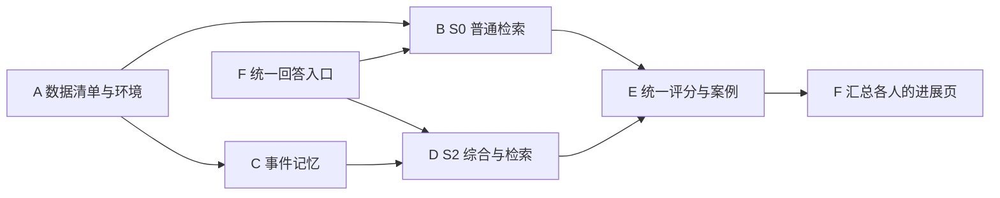

# 长对话结构化记忆复现与优化项目方案（阶段一基线）

> **阶段二衔接（2026-11-03）**：11 月 1 日平时作业已提交归档，目前全组已转入**阶段二：预算约束下的多粒度证据打包**。最新计划与六人分工请直接看 [阶段二完整规划](plans/2026-11-03-phase2.md)、[方向决定](../notes/phase2-direction-decision-20261103.md)、[多粒度离线试点](../reports/phase2-anchor-pilot-20261103.md) 以及 [阶段二总览 #69](https://github.com/YaoYang-123456/NLP-2026-Team08-Structured-Memory/issues/69)（任务 `#70`–`#75`）。
>
> 下文保留 2026-10-21 的**阶段一复现方案与基线结果**供回溯参考。

适用范围：天津大学 2026 年 NLP 课设第 8 队（6 人小组，专题 4 组 2）。

阶段一以 **StructMem 小规模复现**为主：在 LoCoMo 的固定子集上，用同一个回答模型跑通普通检索基线（S0）、去掉跨事件综合的消融（S1）和完整 StructMem（S2），确保代码可复跑、结果可解释。六篇专题论文的对比和代码核查见[复现条件核查](../notes/six-paper-comparison.md)、[论文比较](../notes/paper-comparison.md)与早期 [MetaMem 个人试点](metamem-pilot.md)。

## 1. 阶段一必做范围与边界

| 项目 | 必做范围 |
| --- | --- |
| 数据集 | LoCoMo 固定小子集 |
| 主方法 | 复用 LightMem 官方实现里的 StructMem，不从零重写 |
| 模型 | DeepSeek API 回答模型 + 本地轻量嵌入（注明与论文 OpenAI 配置的差异） |
| 对照组 | S0（Flat RAG）、S1（去跨事件综合）、S2（完整 StructMem） |
| 评价 | 同一题集的总体与分类准确率、实际 token 和费用、典型错例分析 |
| 交付 | 运行说明、配置、结果表、案例分析及汇报材料 |

条件约束：按普通桌面 GPU / 游戏本与几十元 API 预算来设计，不训练基座模型，不依赖实验室 8 卡 DCU，不部署 Hindsight 整套服务、知识图谱数据库或前端界面。六篇论文各有侧重（StructMem 为主线，Hindsight / Semantic XPath 启发检索，MetaMem 启发证据利用分析，HyMEM 启发更新，Text2Mem 启发操作校验），不要求完整复现六套系统。

## 2. 与前期工作和课程节点的衔接

- **早期 MetaMem 个人试点**：[PR #5](https://github.com/YaoYang-123456/NLP-2026-Team08-Structured-Memory/pull/5) 和 [PR #7](https://github.com/YaoYang-123456/NLP-2026-Team08-Structured-Memory/pull/7) 记录了基于 BM25 的本地探索及负结果，保留作为日志与分析参考，不与新的 StructMem 对照混算。
- **平时作业（已于 2026-11-01 归档）**：按[老师分享目录](https://pan.tju.edu.cn/link/AABA36B295D0754F22BAE2EC489FA324C5)的要求，以 LaTeX 报告 + Beamer PPT + 约 60 分钟视频完成提交，详见[平时作业归档](../reports/homework/archive-20261101.md)。
- **第一次课设研讨（2026-10-22，已归档）**：按[研讨通知](course/seminar-notice-20261020.md)准备了 8 分钟汇报与视频（归档入口见 [reports/seminar-20261022/README.md](../reports/seminar-20261022/README.md) 及 [latex-8min/README.md](../reports/seminar-20261022/latex-8min/README.md)）。课设最终验收日期仍以后续通知为准。

## 3. 数据划分与对照设置

使用 [LoCoMo 官方数据](https://github.com/snap-research/locomo) 的 `locomo10.json`（保留会话 ID、session、说话人、时间、消息 ID、题型和证据标注，按 StructMem 论文口径使用 1–4 类，不含 category 5）。

- **会话隔离**：固定划分 **3 个开发会话**和 **7 个留出会话**，同一会话绝不拆到两侧。
- **题单冻结**：开发集固定抽取 **30 题**（覆盖四类题型，含前 5 题联调子集），首次模型运行前冻结，看完结果不换题。正式泛化评测从 7 个留出会话分层抽取约 **100 题**。标准答案仅在最后的评分阶段加载。

| 编号 | 方法 | 作用 |
| --- | --- | --- |
| **S0** | Flat RAG（原始对话块向量检索） | 简单可解释基线 |
| **S1** | StructMem 事件抽取（关闭跨事件综合） | 消融检查综合记忆的作用 |
| **S2** | 完整 StructMem | 主复现结果 |
| **O1（可选）** | S2 加单一冻结改进（现已演进为阶段二多粒度打包） | 检查收益与代价 |

复现沿用 StructMem 论文默认参数：1 小时综合窗口、15 个历史种子、问答检索 60 条事件 + 5 条综合记忆。由于将回答模型和嵌入替换为 DeepSeek + 本地轻量模型，属于方法复现，不与原论文 `gpt-4o-mini` / `text-embedding-3-small` 的 76.82% 直接画等号。

## 4. 代码组织与运行链路

复用上游 [LightMem 的 StructMem 实现](https://github.com/zjunlp/LightMem/blob/8449d574df6bae1bdf3314a1564da65e2f37e046/StructMem.md)（固定 commit），链路为：

`原始对话 → 事件记忆 → 跨事件综合（可选）→ 问答检索 → DeepSeek 回答 → 固定裁判评分与汇总`

| 目录 | 内容 |
| --- | --- |
| `configs/` | 样本清单、模型与检索参数（不含密钥） |
| `scripts/` | 构建、问答、汇总入口 |
| `src/` | 上游适配与核心逻辑 |
| `reports/` | 实验表、案例和汇报材料 |
| `data/`、`output/`、`tmp/` | 本地数据、记忆库与运行输出（不入 Git） |

## 5. 资源与费用记录

抽取、综合、回答和自动裁判统一使用 DeepSeek API（关闭思考模式，设好输出上限）；本地 GPU 负责轻量嵌入。总预算按几十元级别规划，单次小试跑几元量级。各模块直接记录模型名、成功/失败状态、实际 `usage` 和耗时，汇总时按当日[DeepSeek 官方价格](https://api-docs.deepseek.com/zh-cn/quick_start/pricing/)估算费用；没返回 `usage` 的失败请求单列，不按零消耗算。记忆和向量建好后本地复用，避免重复跑全量。

## 6. 阶段一时的优化思路（已由阶段二规划接替）

阶段一在 10 月 22 日研讨时曾列过两个后续候选思路：一是把问答检索条目数从 60 降到 30 看质量/成本权衡，二是若发现漏掉同事件信息则做有限同源补齐。

研讨时我们基于 S0（15/30）和 S2（19/30）的对比注意到：S2 多答对 4 题，但回答输入 token 是 S0 的 **4.42 倍**（586,282 vs 132,531），而且两者的提示词、记忆表示和输入长度都有差异，不能把这 4 题简单归功于某一个模块。基于这一观察，11 月 3 日完成了开发集错题诊断和两轮离线试点，最终确定将优化方向升级为[阶段二的多粒度证据打包](plans/2026-11-03-phase2.md)。

## 7. 评价与验收标准

- **必报指标**：总体与各题型的正确数 / 固定总题数、有效评分覆盖率、各阶段 tokens、费用和耗时；保留固定裁判的原始判定。
- **人工案例核查**：抽 10–20 个成功/失败案例对照原文检查，按“抽取遗漏 / 检索缺失 / 综合错误 / 证据利用错误”定位原因，并与自动裁判结果分别记录。
- **失败不删题**：生成或裁判失败与正常答错分开统计，保持固定总题数，绝不靠删失败题抬高准确率。
- **可复跑性**：保存上游 commit、配置、题单、提示词和返回模型名。

## 8. 阶段一六包分工（历史记录）

| 包 | 负责人 | Issue | 负责内容与阶段一产出 |
| --- | --- | --- | --- |
| A：数据与环境 | `ngocnamd93-spec` | [#26](https://github.com/YaoYang-123456/NLP-2026-Team08-Structured-Memory/issues/26) | 固定 LoCoMo 数据与上游版本；生成 3/7 会话划分、30 题与 5 题清单及环境脚本（`scripts/prepare_locomo.py`、`configs/locomo-smoke.json`） |
| B：S0 普通检索基线 | `YaoYang-123456` | [#24](https://github.com/YaoYang-123456/NLP-2026-Team08-Structured-Memory/issues/24) | 原始对话分块、MiniLM 嵌入、top-60 检索并接入 F 回答入口（`src/flat_rag.py`） |
| C：StructMem 事件记忆 | `oioioi-521` | [#32](https://github.com/YaoYang-123456/NLP-2026-Team08-Structured-Memory/issues/32) | 适配上游事实/关系双路抽取与事件绑定，交付开发集完整事件库（`src/structmem_build.py`） |
| D：StructMem 综合与检索 | `lanshuheng9-oss` | [#28](https://github.com/YaoYang-123456/NLP-2026-Team08-Structured-Memory/issues/28) | 接 C 事件库运行跨事件综合，完成 S2（60+5）检索与回答联调（`src/structmem_retrieve.py`） |
| E：评分与结果分析 | `onlysonder` | [#31](https://github.com/YaoYang-123456/NLP-2026-Team08-Structured-Memory/issues/31) | 固定裁判评分、按主键关联答案、分类统计与错误案例分析（`scripts/evaluate.py`） |
| F：统一回答与联调 | `hycx233` | [#19](https://github.com/YaoYang-123456/NLP-2026-Team08-Structured-Memory/issues/19) | 统一 DeepSeek 回答客户端与接口、B/D/E 联调及汇报材料整合（`src/llm_client.py`、`scripts/run_qa.py`） |

（注：早期单人整条试跑任务 [#16](https://github.com/YaoYang-123456/NLP-2026-Team08-Structured-Memory/issues/16) 已改为上述六人并行分工并关闭。）

## 9. 阶段一协作链路与三项接口契约

1. **输入清单**：包含 `sample_id`、`qa_index`、`question`、`category`；会话文本单独传入，标准答案和 evidence 只交给 E。
2. **检索 → 回答**：B / D 给 F 传入题目和带来源 ID 的上下文，F 统一模型、提示词和参数。
3. **回答 → 评分**：每题保存方法名、题目主键、预测、来源、状态、耗时和 `usage`，由 E 关联答案评分。

## 10. 当前进展与下一步

> 以下为 **2026-10-21 阶段一收口快照**（阶段二当前状态请看 [#69](https://github.com/YaoYang-123456/NLP-2026-Team08-Structured-Memory/issues/69)）。

| 包 | 阶段一完成情况 | 备注与遗留项 |
| --- | --- | --- |
| A | #38 已合、#26 结项：固定 3/7 会话划分、30 题与 5 题清单 | 留出抽样转入阶段二 #70 |
| B | #37 / #45 已合、#24 结项：完成 S0 真实检索与汇报页 | 阶段二转入 #71 |
| C | #43 已合、#32 结项：91 个 session、3,712 条事件已交 D 验收 | 沿用关闭压缩/话题切分配置，阶段二转入 #72 |
| D | #41 已合、#28 结项：91 条真实综合、30 题 S2 回答（含 4 次弃答） | S1 消融转入阶段二 #73；原生 91 条完整综合待导出 |
| E | #46 已合：60 条逐题裁判、输入指纹与分数已由 F 复算一致（见[复算记录](../reports/e-score-verification-20261021.json)） | 阶段二多方案评分与人工复核转入 #74 |
| F | 完成统一回答入口、S0/S2 交接、评分核验与 10 月 22 日研讨材料归档 | 阶段二预算接口与整合转入 #75 |

### 阶段一 30 道开发题基线结果

同一 30 道冻结开发题上的固定裁判结果（有效评分覆盖率均为 30/30，无生成或裁判失败，裁判总用量 9,293 输入 + 60 输出 = 9,353 tokens）：

| 题型 | 题数 | S0 原始自动判分 | S0 日期裁定后 | S2 完整 StructMem |
| --- | ---: | ---: | ---: | ---: |
| 1 多跳 | 8 | 4 | 4 | 4 |
| 2 时间 | 8 | 6 | 5 | 7 |
| 3 开放域 | 7 | 2 | 2 | 3 |
| 4 单跳 | 7 | 4 | 4 | 5 |
| **合计** | **30** | **16（53.3%）** | **15（50.0%）** | **19（63.3%）** |

说明：
- S0 唯一一次人工改判是 `conv-42 / qa_index 28` 的日期题（原始自动裁判判 `yes`，对照原文和答案改判为 `no`，保留原始记录）；
- `conv-42/61`、`conv-41/41` 等存在参考证据局限，均保留原标签与分母 30；
- S0 和 S2 的提示词与输入长度不同（S2 回答输入 tokens 约为 S0 的 4.42 倍），且仅测了 30 道开发题，后续在阶段二统一预算与提示词后再做严格对照。
