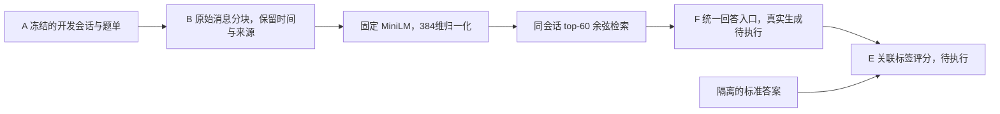

# B：S0 本机真实检索与交接记录

负责人：`YaoYang-123456`，任务 [#24](https://github.com/YaoYang-123456/NLP-2026-Team08-Structured-Memory/issues/24)。2026-10-19。**固定5题与30题真实向量检索完成，F模拟接口通过；真实回答、评分均未执行。** 本记录不表示整个B任务验收通过。

## 1. 输入、版本与实际集成



核对时 main 为 `9e2e0d6`；A #38 `1d651da`、B #37 `ba5aada`、F #35 `4206096`、MetaMem #40 `e4c9849` 均未合并。本机从B建立独立本地worktree，只在本地叠加A/F交接文件，未合并远端PR或修改成员分支。复跑须取得这些兼容文件；只检出main尚不能运行。

|项目|实际值|
|---|---|
|LoCoMo原始版本|`cbfbc1dba6bc53d00625212a0f22d55ffee7c1fc`|
|原文件SHA-256|`79fa87e90f04081343b8c8debecb80a9a6842b76a7aa537dc9fdf651ea698ff4`|
|开发集|conv-48、conv-42、conv-41；30题，前5题联调；题型8/8/7/7|
|语料|91个session、1973条消息，共1973个原始对话块；各会话681/629/663块|
|嵌入|all-MiniLM-L6-v2，revision `1110a243fdf4706b3f48f1d95db1a4f5529b4d41`，384维、归一化、CPU、256-token上限|
|检索|480字符分块，top-60余弦排序；保留原始时间、说话人与来源ID|
|环境|独立Python3.12.14，torch2.11.0+cpu，sentence-transformers5.1.2，transformers4.57.1，huggingface-hub0.36.0，numpy2.5.4|

原机已有Python3.14及其他环境未改动。数据准备采用A原脚本，会解析完整官方文件以审计并重建冻结开发数据；没有将留出会话用于检索、回答、调参或评分。B仅读取开发conversation与inputs，不读取labels或标注evidence。没有重复运行旧MetaMem数据/模型实验。

## 2. 实际检查与结果

|阶段|完成状态|结果|
|---|---|---|
|A/B/F针对性检查|通过|7＋8＋14＝29项，新环境实际执行，日志保留|
|模型离线加载|通过|2×384、有限值、范数均1、同输入一致性；CPU|
|固定5题真实检索|5/5|每题60块；命令墙钟16.822秒，包含模型加载与首次语料嵌入|
|5题送F模拟|5/5 simulated|真实成功回答0；0.247秒|
|固定30题真实检索|30/30|每题60块；8.949秒，复用第一次的语料嵌入缓存|
|30题送F模拟|30/30 simulated|真实成功回答0；0.266秒|
|产物核验|通过|来源原文与时间完全绑定、排序递减、题目联合主键正确、F直接读取、5题与30题对应行逐字相同|
|真实回答/评分|未执行|0次生成、0条真实判分；准确率、真实输出token与费用结果均为空|

本次离线执行序列含测试和加载共48.958秒，**不含之前的安装、下载和材料整理**。两个检索耗时因缓存状态不同，不能作为算法速度比较。5题是30题子集，独立题目总数仍为30。没有嵌入截断错误或模型调用失败；模拟占位回答不能送入真实评分。

F读取后的题集哈希：5题 `a5108b7645af41f8b257d3033e968be47160f2e696789c0c85a21c14250b9ac5`；30题 `99ebf28b673b715886b13d8f88768cc82b1775033b37d59ffae0893b285c0a26`。

## 3. 真实检索案例（尚无回答及正确性判定）

主键 `("conv-42", 15)`，问题：**When did Nate get purple hair?**（Nate什么时候染了紫色头发？）

|排名与相似度|实际来源|可观察内容|
|---|---|---|
|1，0.590541|`conv-42:session_7:D7:1:0`|会话时间为2022年4月15日19:37，Nate说“Dyed my hair last week”|
|2，0.502972|`conv-42:session_7:D7:3:0`|同会话消息，已有BLIP描述提到紫色头发；图片本身未下载|
|3，0.486144|`conv-42:session_10:D10:4:0`|5月2日的游戏/比赛消息，图片描述也包含紫发，可能形成干扰|

这例说明原始向量检索能同时带回时间线索和外观线索，也会取回词面相近的干扰。回答阶段仍需把“last week”绑定到原会话时间，并判断是否同一事件。**未读取本题标准答案来评价此案例，不据检索排名宣称已答对，也不据此计算证据召回率。** 完整原文、60条排名与分数保存在本地交接包，人工验收留空。

## 4. 本机复跑命令

当前工作目录：`D:\2026下\实验\NLP\tmp\s0-integration-20261019`。独立解释器：`D:\2026下\实验\NLP\tmp\s0-venv-20261019\Scripts\python.exe`。以下使用新的输出名称，不覆盖本次产物。

```powershell
$python = 'D:\2026下\实验\NLP\tmp\s0-venv-20261019\Scripts\python.exe'
$env:HF_HUB_OFFLINE = '1'
$env:OMP_NUM_THREADS = '4'
$env:MKL_NUM_THREADS = '4'
& $python scripts/check_locomo_environment.py --local-files-only --report output/s0-recheck-environment.json
& $python scripts/run_s0.py --selection data/locomo/smoke.inputs.json --out output/s0-recheck-smoke5
& $python scripts/run_qa.py --mock --method S0 --input output/s0-recheck-smoke5/s0.inputs.jsonl --out output/s0-recheck-qa-mock5
& $python scripts/run_s0.py --selection data/locomo/development.inputs.json --out output/s0-recheck-dev30
& $python scripts/run_qa.py --mock --method S0 --input output/s0-recheck-dev30/s0.inputs.jsonl --out output/s0-recheck-qa-mock30
```

A原文件及5个输出哈希均与冻结配置一致。已经生成的数据无需重新下载；模型完整缓存可离线复用。实际命令、返回码、分阶段耗时和依赖清单见本地`output/s0-local-20261019/`。

## 5. F/E交接与具体阻塞

当前30题真实检索输入可直接交F，路径为`output/s0-local-20261019/dev30/s0.inputs.jsonl`；5题路径同理。每行严格五字段，contexts严格三字段。模拟输出放在单独`qa-mock-*`目录，不能当作真实预测。

这台机器的进程环境没有`DEEPSEEK_API_KEY`，项目根目录没有`.env`或`.env.local`；未扫描其他课程密钥。现有项目方案中的“几十元/约5元量级”不是可确认的本次实际调用分配。F交付的配置仍标为接口示例，应先冻结实际S0回答配置并保留版本。因此没有发起付费请求，实际API费用为0，真实token用量未知而非模拟值。

最小后续动作：在本机安全配置项目凭据，明确本轮付费额度及F配置，然后先5题真实回答，成功后完成30题并交 E [#31](https://github.com/YaoYang-123456/NLP-2026-Team08-Structured-Memory/issues/31)。若直接沿用现有F入口分别跑5和30行，最多35次请求，其中5题会重复；这是需明确的调用数，不能报成35道独立题。应由F决定能否复用已完成5题，B不擅自改其客户端。

E目前只能取得未评分输入及计划清单，没有可供真实评分的预测；不开发或修改E的评分器。人工核查/验收：________。

## 6. ZIP、MetaMem材料与保存

ZIP从Downloads移动至项目根，352,064字节，移动前后SHA-256均为`3b8a57c65fb7e5254941938dda3a84f2a6fd0a4df1528e56a34964c61e36b96b`。保留ZIP，独立解压10项、381,431字节，CRC和路径边界检查通过；没有覆盖仓库文件。B代码/测试及MetaMem幻灯片源与相应PR一致；B文档不同，MetaMem正文仅引号样式差异，均保留原件。

MetaMem现成预览3页正文、7页幻灯片已逐页查看；原文Figure1、Table1/2、A.3/A.5的关键数字和设置核对通过。未发现应修改的事实错误，未动其他论文章节。当前共享版式重新编译的接口未及时返回诊断，已停止等待，**不称本轮全组编译成功**；原预览可用，讲解人待填写、本人阅读验收仍未完成。

原始数据、模型与完整日志留本地。`model.safetensors`为90,868,376字节，SHA-256 `53aa51172d142c89d9012cce15ae4d6cc0ca6895895114379cacb4fab128d9db`；若需组内交接，**请将该文件发送到小组微信群**，不提交Git。CPU进程结束后GPU采样为0MiB、0%；本轮未启动Ollama。
